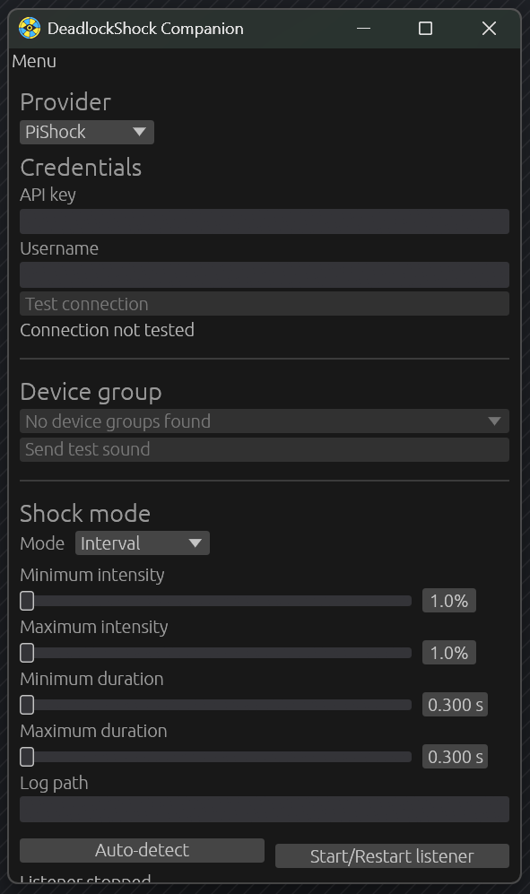

[](https://gamebanana.com/mods/700758)

# DeadlockShock

DeadlockShock is a small UI mod and companion app that can sync local-player deaths, ability uses, and cooldown readiness to external shockers.
Made because my friend complained about OCR missfiring for them.

## !!! Required Deadlock mod !!!

The companion app does not work by itself. Install and enable the [DeadlockShock mod from GameBanana](https://gamebanana.com/mods/700758) in Deadlock before starting the companion. The mod detects gameplay events and writes them to the log that the companion listens to.

## Contents

- `mod/` has the Panorama gameplay-state hook.
- `companion/` is the desktop app.
- `pishock/` and `openshock/` talk to the two shock providers.

## Preview

[](./media/showcase.png)

## Building from source

You will need [Rust](https://rust-lang.org/), [PowerShell](https://learn.microsoft.com/en-us/powershell/), and [Reduced CSDK 12](https://deadlockmodding.pages.dev/modding-tools/csdk-12).

From the repo root:

```powershell
.\build.bat
cargo build --manifest-path companion/Cargo.toml --release
```

That puts the addon at `dist/deadlock_death_hook.vpk`. Install and enable it in Deadlock, then start the companion:

```sh
cargo run --manifest-path companion/Cargo.toml --release
```

In **Setup**, pick PiShock or OpenShock, enter the provider's typed setup values, test the connection, select a device group when the provider requires one, and try the test sound.

PiShock uses only an API key with the [public HTTP API](https://api.pishock.com/swagger/index.html); no username is required. Device groups include your own hubs and hubs shared with your account. Its command API requires V3 firmware and a claimed share code for each shocker, including ones you own. Create and claim those shares on PiShock before connecting the companion. Existing saved API keys and device-group selections are retained when upgrading. Commands use milliseconds and the permissions of a specific share; multiple shares of one shocker do not send duplicate commands.

In **Effects**, configure Death, Ability use, and Cooldown ready independently. Each trigger has its own explicit provider action profile; the currently available providers expose the same fixed or random-interval shock editor. Ability-use and cooldown-ready also have independent positional-slot filters that apply across heroes; ability names appear when the addon reports them, with numbered slots as the fallback. Use the explicit Copy control to copy only the active action family between profiles without changing enablement or ability selection. Local-player death is enabled by default, while both ability triggers are opt-in. Cooldown ready covers both a normal cooldown finishing and a charged ability restoring a charge.

In **Game connection**, the companion automatically resumes a saved `console.log` path or auto-detects Deadlock and starts the listener at launch. Use **Auto-detect** and **Start/Restart listener** for diagnostics, retry, or a manual path override. Deadlock must run with `-condebug` so the log is written.
On Windows releases the companion uses the GUI application subsystem, so launching it from Explorer does not open a command window. On Windows and Linux, open **Menu → Show logs** for selectable startup and live diagnostics. Logs are retained only in memory for the current run and are not written to a persistent log file.

The companion remembers your setup—including both providers' setup values, all three action profiles, and ability filters—in your OS user config directory. Ability names are runtime diagnostics and are not saved.

## Provider/action architecture

The companion uses exhaustive built-in provider descriptors and typed extension points. `src/provider.rs` owns provider setup snapshots, target policy, optional typed test-action capabilities, connected blocking clients, tagged targets, test operations, execution, disconnect, and redacted errors. `src/action.rs` owns action families, validation, immutable resolution, safe summaries, and persistence-facing settings banks; `src/action_ui.rs` contains explicit egui editors. Event acceptance resolves an action before a bounded worker queue, so later UI edits cannot change queued work and provider calls never run on the egui thread. Optional and no-target policies pass `None` through orchestration; required adapters reject it before library calls.

Saved state is strict schema 5 JSON. Schema 1 through 4 states migrate into provider setup and per-trigger action banks while preserving API keys, selected provider, preferred target, filters, enablement, and log path. The obsolete PiShock username is discarded. Available PiShock/OpenShock behavior remains shock-specific and uses the same portable bounds and at-most-once queue semantics.

## Publishing a release

The companion and Panorama mod are versioned independently. The Git release tag matches the companion's Cargo version. `companion/mod-compatibility.json` declares the mod versions supported by that companion; its current range, `^0.1.0`, accepts stable mod versions from `0.1.0` up to but excluding `0.2.0`. This declaration is embedded in the companion for compatibility warnings and read by the release tests.

1. Choose the companion release version and update `companion/Cargo.toml` and its lockfile. Review the declared mod compatibility range; companion-only changes can retain the existing range and mod version.
2. Run `bun test tests/death_http_bridge.test.js` and the affected companion tests. The bridge test checks that the emitted mod version falls within the companion's supported range, without requiring matching release versions.
3. Only when the mod itself changes, update `MOD_VERSION` in `mod/panorama/scripts/death_http_bridge.js`, build and smoke-test the VPK separately on Windows, and publish it on [GameBanana](https://gamebanana.com/mods/700758) under its own version. Companion-only releases require no VPK rebuild or mod update.
4. Push the tag matching the tested companion version:

```sh
git tag v<version>
git push origin v<version>
```

Drone verifies `DRONE_TAG == v<companion Cargo version>` and the mod compatibility declaration before building companion artifacts. A newer companion release does not make a supported mod outdated. Missing or unsupported mod versions produce informational notices; gameplay-event parsing continues to require the supported log schema. The current pipeline does not build or upload the VPK; do not claim a tagged release contains the addon unless it was built and verified separately.
